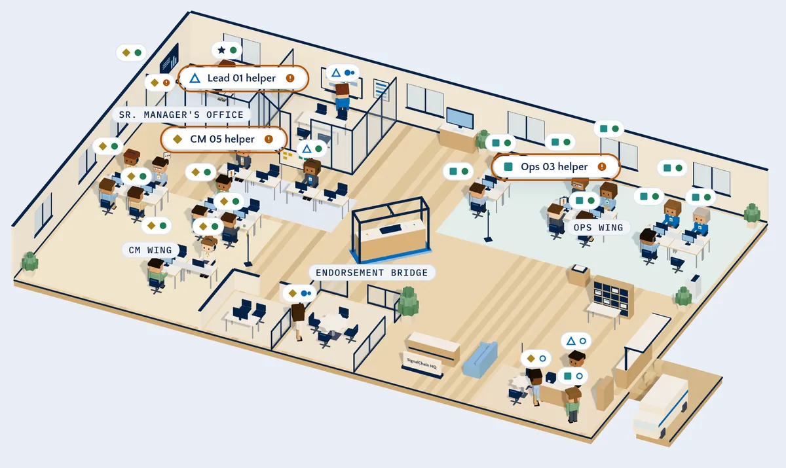
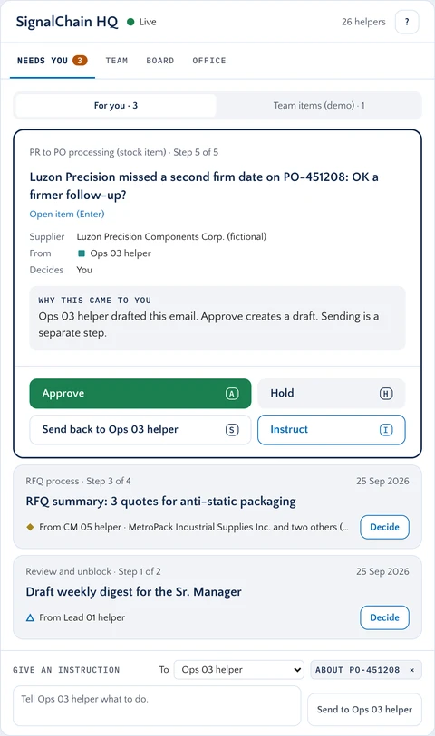
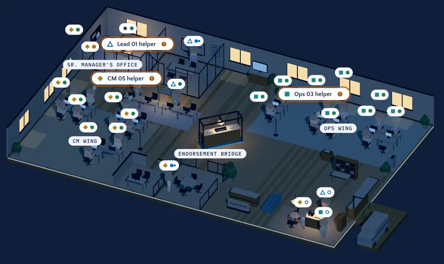
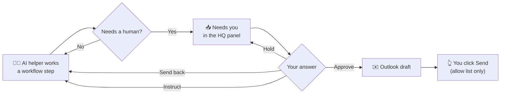
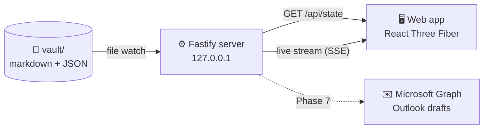

<div align="center">

<picture>
  <source media="(prefers-color-scheme: dark)" srcset="docs/readme/office-night.webp">
  
</picture>

# SignalChain HQ

**A cozy isometric office where AI helpers do procurement work, and you decide what goes out.**

`Unofficial prototype` · `Fictional data` · `Private repo` · `Local-first`

[What it is](#what-it-is) · [Tour the office](#tour-the-office) · [Features](#features) · [How a decision flows](#how-a-decision-flows) · [Run it](#run-it) · [Progress](#progress)

</div>

> [!TIP]
> The office at the top is a real recording of the running app. Switch GitHub to dark mode and the same office shows at night.

---

## What it is

A game-like office you can watch and walk around in. It has **26 seats**, shaped like a real procurement team:

| Seat | Count | Badge | What their helper does |
|---|---|---|---|
| Sr. Manager | 1 | ★ star | That is you, the player. You decide. |
| Lead | 4 | △ triangle | Reviews, unblocks, and writes the weekly digest. |
| Category Manager (CM) | 11 | ◆ diamond | PR approval, RFQs, contracts, supplier talks. |
| Ops Buyer | 10 | ■ square | PR to PO in SAP, eRFQ to PO, PO changes, delivery follow-ups. |

Every seat holds an **AI helper** (a small software worker that copies the steps of a real role). The helpers work through the team's six real workflows. When a helper needs a human, its work lands in **Needs you**, and you pick one of four answers.

**What it is not:** an ADI product, a system with real data, or a tool that watches people. The office shows what the AI helpers do, never what a real person does.

---

## Tour the office

Click a zone to open it.

<details>
<summary><b>🌉 Endorsement Bridge</b>, the heart of the office</summary>

<br>

The glass counter in the middle. This is where a CM's work gets handed over to Ops. Helpers walk here when a PR is endorsed, so you can see work move from one side of the team to the other.
</details>

<details>
<summary><b>◆ CM Wing</b> and <b>■ Ops Wing</b>, where the helpers sit</summary>

<br>

Category Manager helpers sit on the left, Ops Buyer helpers on the right, on a light teal rug. Each helper has its own look (hair, outfit, accessory) made from a seed, so no two are the same.
</details>

<details>
<summary><b>★ Sr. Manager's Office</b> and <b>△ Leads' Row</b></summary>

<br>

Your glass office sits at the back, next to the Leads' review board. The dashboard wall and the Needs you tray live here.
</details>

<details>
<summary><b>The other zones</b>, where helpers go on trips</summary>

<br>

| Zone | Why a helper walks there |
|---|---|
| SAP Station | To create or change a PO in SAP |
| Contract Corner | To sign and file contracts |
| Negotiation Room | To prepare a supplier call |
| Huddle Room | For a team meeting |
| Mail Dock | To drop an email draft for your review |
| Logistics Window | To check a delivery with the loading dock |
| Reception | The front desk with the "SignalChain HQ" sign |
| Merienda Corner | A short break by the coffee cart (scenery only) |
</details>

---

## Features

<details open>
<summary><b>👀 Watch the helpers work</b></summary>

<br>

- Each helper has a live status from the local server: working, waiting, in a meeting, on a trip, recharging, or paused.
- Working helpers type. A helper that **waits on you** raises a hand and shows an amber **!**. A helper that waits on someone else shows a hollow **...**.
- A step in another zone means a real trip: the helper finds a path (A star on a 0.5 m grid), walks there, works for a moment, and walks back.
- Name tags float over every helper with a badge, a name, and a status dot. They spread out so they never cover each other or the zone names.
</details>

<details>
<summary><b>✅ Decide in the HQ panel</b></summary>

<br>



The panel on the right has four tabs:

- **Needs you**: items sorted by urgency, then escalations, then rule items, then email drafts. Each one says **why it came to you**.
- **Team**: every helper, its workflow steps, and which step is now. Click a row and the camera flies to that helper.
- **Board**: Waiting on a decision, Doing, To do, and Done today.
- **Office**: camera views, day and night, props, and sound.

For each item you choose:

| Key | Answer | What happens |
|:-:|---|---|
| <kbd>A</kbd> | Approve | The work moves on. An email becomes a draft, never a sent mail. |
| <kbd>H</kbd> | Hold | It waits, and stays in your list. |
| <kbd>S</kbd> | Send back | It goes back to the helper to redo. |
| <kbd>I</kbd> | Instruct | You type what the helper should do next. |

Every decision has a **5 second undo**.

<br clear="right">
</details>

<details>
<summary><b>🚶 Walk around</b></summary>

<br>

Press <kbd>G</kbd> or click **Walk around** to become a character in the office.

| Key | What it does |
|:-:|---|
| <kbd>W</kbd> <kbd>A</kbd> <kbd>S</kbd> <kbd>D</kbd> or arrows | Walk. You can also click the floor. |
| <kbd>E</kbd> | Talk to the nearest helper and open its card |
| <kbd>Esc</kbd> | Stop walking and go back to the Overview |
| <kbd>1</kbd> to <kbd>5</kbd> | Jump to a camera view (5 is the Endorsement Bridge) |

The camera follows you. A "Talk" hint shows when you are within 1.5 m of a helper.
</details>

<details>
<summary><b>🌙 Day and night</b></summary>

<br>



Day is soft daylight. Night is navy with a moon, warm lamps, glowing windows and screens. The switch blends through dusk in 1.2 seconds. With reduced motion turned on, it fades instead.
</details>

<details>
<summary><b>⚖️ The authority rule</b></summary>

<br>

Some decisions are not yours alone. When the rule routes an item, the card says **who must decide and why**, in the rule's own words from `data/authority-rules.template.json`. Gaps in the rule go to the CM. The thresholds are placeholders until they are confirmed.
</details>

<details>
<summary><b>✉️ Outlook, drafts first</b> (Phase 7)</summary>

<br>

- Approve creates a **draft**. Sending is a separate click.
- Sending needs `MAIL_MODE=send`, and every recipient must be on the allow list. Every send is logged.
- A personal test account only. No ADI accounts or tenants.
</details>

<details>
<summary><b>🛡️ Built for trust</b></summary>

<br>

- Fictional suppliers, PO numbers, emails and people. Seats use placeholders like "CM 03".
- No time tracking, activity monitoring, productivity scores, or "who is online" for real people.
- ADI-inspired colors and font, no ADI logo. The app says "Unofficial prototype · Fictional data".
- The server listens on 127.0.0.1 only.
</details>

---

## How a decision flows



<details>
<summary><b>How the pieces talk to each other</b></summary>

<br>



- **vault**: plain files on your Mac that hold the team, tasks, and office layout. Save a file and the office updates live, with no reload.
- **SSE** (Server-Sent Events): a one-way live stream from the server to the browser.
- **packages/shared**: the zod schemas (data shape checks) that both sides use.
</details>

---

## Run it

You need macOS, Node 24 LTS, and pnpm.

```bash
pnpm install          # once per folder
pnpm e2e:install      # once per machine: the browser for tests and screenshots
pnpm dev              # starts the web app and the local server
```

Then open the web address it prints (the main checkout uses http://127.0.0.1:5173).

<details>
<summary><b>All commands</b></summary>

<br>

| Command | What it does |
|---|---|
| `pnpm dev` | Web app and server. The main checkout uses ports 5173 and 4317. Each worktree gets its own ports |
| `pnpm check` | Type check, lint, unit tests, and a check of `data/` and `vault.sample/` |
| `pnpm e2e` | Browser tests (starts the app if it is not running) |
| `pnpm shots` | Screenshots to `docs/qa/shots/<date>/` |
| `pnpm vault:reset` | Saves your live `vault/` to `vault-backups/`, then makes a fresh copy of `vault.sample/` |
| `pnpm format` | Formats all files with Biome |

The first `pnpm dev` copies `vault.sample/` into `vault/` (gitignored). Later runs only add files that are missing. They never overwrite your edits.
</details>

<details>
<summary><b>Handy links while it runs</b></summary>

<br>

| Address | What you see |
|---|---|
| `/` | The office and the HQ panel |
| `/?time=night` | Start at night |
| `/?walk=1` | Start in Walk around |
| `/?view=bridge` | Start at a camera view: `overview`, `cm`, `ops`, `mgr`, or `bridge` |
| `/lab` | The design Lab: colors, type, name tags, the diorama |
| `/lab/floorplan` | Floor plan options with the six workflow routes |
</details>

<details>
<summary><b>Tech stack</b></summary>

<br>

| Part | Tools |
|---|---|
| `apps/web` | Vite, React 19, React Three Fiber, drei, zustand, Tailwind CSS v4, motion |
| `apps/server` | Fastify, Server-Sent Events, chokidar, gray-matter, zod, MSAL Node, Microsoft Graph |
| `packages/shared` | zod schemas and types for web and server |
| Tests | Vitest for logic, Playwright for end-to-end and screenshots |
| Tooling | pnpm monorepo, TypeScript strict, Biome |

More in [docs/TECH_STACK.md](docs/TECH_STACK.md).
</details>

---

## Progress

- [x] 0. Kickoff and alignment
- [x] 1. Scaffold and tooling
- [x] 2. Design direction in the Lab
- [x] 3. The office world
- [x] 4. The team, characters and movement
- [x] 5. The HQ panel
- [ ] 6. Live data and Demo Day
- [ ] 7. Outlook
- [ ] 8. Polish and v0.1.0

Full log: [docs/PROGRESS.md](docs/PROGRESS.md). Every choice: [docs/DECISIONS.md](docs/DECISIONS.md).

<details>
<summary><b>How we build</b></summary>

<br>

- **Segments with gates**: plan, build, see, council, checkpoint. Claude stops and waits after each segment.
- **Worktrees**: one per phase (`claude -w p3-office`). Phases 4 and 5 ran in parallel. See [docs/WORKTREES.md](docs/WORKTREES.md).
- **Design Council**: `/design-council <topic>` runs ten personas in parallel on real screenshots, then the creative-director ranks the fixes.
- **Checkpoints**: `/checkpoint` runs the checks, updates progress and decisions, and proposes a commit.
</details>

<details>
<summary><b>What is in the repo</b></summary>

<br>

| Path | What it does |
|---|---|
| `apps/web/` | The 3D office and the HQ panel |
| `apps/server/` | Local API, vault, simulator, mail |
| `packages/shared/` | Schemas and types |
| `data/` | Roster template (26 placeholder seats), the six workflows, the authority rule template |
| `vault.sample/` | Example vault: team status, Needs you items, board tasks, office layout and props |
| `docs/` | Plan, prompts, architecture, decisions, progress, design, QA |
| `.claude/` | The council and crew personas, skills, and path rules |
| `.githooks/` | Sole contributor hooks |
| `scripts/` | Setup and checks |
</details>

<details>
<summary><b>All docs</b></summary>

<br>

- [Implementation plan](docs/IMPLEMENTATION_PLAN.md)
- [Prompt pack](docs/PROMPTS.md)
- [Tech stack](docs/TECH_STACK.md)
- [Architecture](docs/ARCHITECTURE.md)
- [Team template](docs/TEAM_TEMPLATE.md)
- [Outlook setup](docs/OUTLOOK_SETUP.md)
- [Worktrees guide](docs/WORKTREES.md)
- [Design references](docs/DESIGN_REFERENCES.md)
</details>

---

<div align="center">
<sub>SignalChain HQ · Unofficial prototype · Fictional data · Built by Lawrence Panes</sub>
</div>
