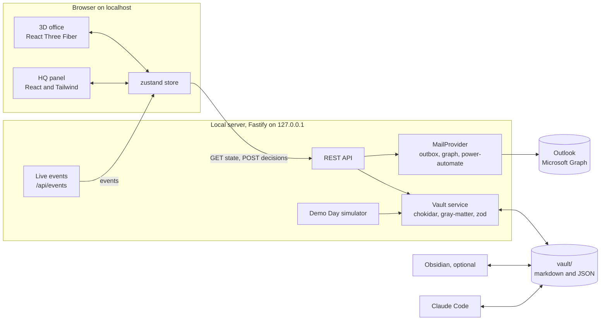

# Architecture

Plain version: the browser shows the office and the panel. A small server on your laptop reads and writes a folder of markdown and JSON files (the vault) and pushes live updates to the browser. When you approve an email, the server creates a draft through the mail driver (a local file, or your Outlook through Microsoft Graph). Claude Code and Obsidian can read and edit the same vault files.



## Repo layout (after Phase 1)

```
apps/
  web/
    src/
      scene/        3D world (isometric-office skill)
      ui/           panel, HUD, tabs, dialogs
      state/        zustand store and SSE client
      theme/        tokens.ts, theme.css
      lab/          design Lab routes (/lab, /lab/diorama, /lab/floorplan, /lab/panel)
    e2e/            Playwright tests and the shots script
  server/
    src/
      routes/       health, state, queue, instructions, sim, mail, auth
      vault/        load, watch, write, validate
      sim/          Demo Day simulator
      mail/         MailProvider and drivers
      auth/         MSAL sign-in (Phase 7)
packages/
  shared/
    src/            zod schemas, types, event union, authority rule helper
data/               roster, workflows, authority rules (committed templates)
vault.sample/       example vault (committed)
vault/              live vault (gitignored)
scripts/            setup, ports, verify
```

## Where each kind of data lives

| Data | File | Who changes it |
|---|---|---|
| Seat identity and desk placement | `data/roster.template.json`, merged with `data/roster.local.json` if present | You, through `/define-role` |
| Workflows and steps | `data/workflows.json` | You and the procurement-sme |
| Authority rule | `data/authority-rules.template.json` | You, after confirming thresholds |
| Seat live status | `vault/team/<seat>/profile.md` | Server, simulator, Claude Code |
| Needs You items | `vault/queue/<id>-<slug>.md` | Helpers create, you decide |
| Board tasks | `vault/board/<id>.md` | Helpers, simulator, inbox-to-task |
| Office zones, layout, props | Master in `vault.sample/office/*.json` (committed), live copy in `vault/office/` | Design phases write the master, you can tweak props live |
| Activity log | `vault/log/<date>.md` | Server (append only) |
| Your instructions | `vault/instructions/*.md` | The instruction box |
| Email drafts (outbox driver) | `vault/outbox/*.eml` | Mail driver |
| Mail sync state | `vault/.state/mail.json` | Mail driver |
| Demo Day data | `vault-demo/` (gitignored, reset at every Demo Day start) | Simulator only, so the live vault stays clean |

## File format
One record per file. YAML frontmatter holds the data, the body holds text for humans. Example queue item:

```markdown
---
id: "q-0001"
title: "Follow-up to Luzon Precision Components: firm ship date for PO-451208"
kind: "email-draft"          # email-draft | summary | approval | escalation | report
status: "needs-you"          # needs-you | approved | held | sent-back | instructed | sent | done
from: "ops-03"
approver: "mgr-01"
track: "OPS"
workflow: "ops-pr-to-po-stock-item"
step: "acknowledge"
supplier: "Luzon Precision Components Corp. (fictional)"
created: "2026-09-25T08:40:00+08:00"
updated: "2026-09-25T08:40:00+08:00"
email:
  to: ["orders@luzonprecision.example"]
  cc: []
  subject: "PO-451208: please confirm a firm ship date by 29 Sep"
decision: null               # later: { action, by, at, note }
---
## Summary
...
```

## Core shapes (zod in `packages/shared`, refine in Phase 1)

```ts
type Track = "MGR" | "LEAD" | "CM" | "OPS";
type SeatStatus = "working" | "waiting-on-you" | "in-meeting" | "on-break" | "off-duty";

interface Seat {           // roster + local override + live profile, merged by the server
  id: string; track: Track; displayName: string; roleTitle: string; isPlayer: boolean;
  zone: string; pod: string | null; site: "PH" | "TH" | "TBD";
  helper: { name: string | null; bio: string | null };
  workflows: string[]; defaultApprover: string | null; avatarSeed: number; placeholder: boolean;
  status: SeatStatus; workingOn?: string; currentWorkflow?: string | null; currentStep?: string | null;
}

type Decision = { action: "approve" | "hold" | "send-back" | "instruct"; by: string; at: string; note?: string };

type ServerEvent =
  | { type: "state.snapshot"; state: AppState }
  | { type: "seat.updated"; seat: Seat }
  | { type: "queue.upserted"; item: QueueItem }
  | { type: "task.upserted"; task: Task }
  | { type: "office.updated"; office: OfficeState }
  | { type: "log.appended"; line: string }
  | { type: "mail.status"; status: MailStatus }
  | { type: "sim.tick"; clock: string; speed: number }
  | { type: "warning"; message: string };
```

## HTTP API (local only)

| Method and path | What it does | Phase |
|---|---|---|
| `GET /api/health` | Server is up, versions, vault path | 1 |
| `GET /api/state` | Everything the UI needs: seats, queue, tasks, office, workflows, stats, warnings | 1 |
| `GET /api/events` | Server-Sent Events stream, heartbeat every 15 s | 1 |
| `POST /api/queue/:id/decision` | `{ action, note? }`. Updates the item, the seat, and the log | 6 |
| `POST /api/instructions` | `{ target: seatId or "team", text }` | 6 |
| `POST /api/sim` | `{ running, speed, seed }` Demo Day control | 6 |
| `GET /api/mail/status` | Mail driver status for the Mailroom tab | 7 |
| `POST /api/queue/:id/draft` | Create the email draft for an approved item | 7 |
| `POST /api/queue/:id/send` | Send the draft, only if safety rules pass | 7 |
| `POST /api/digest/send` | Send the daily digest now | 7 |
| `GET /auth/login`, `GET /auth/callback`, `POST /auth/logout` | Microsoft sign-in with PKCE | 7 |

The web app calls `/api` and `/auth` through the Vite dev proxy, so the browser only talks to one origin.

## Ports and worktrees
`scripts/ports.mjs` (Phase 1) picks ports per worktree: the main checkout uses web 5173 and API 4317, and each worktree adds a stable offset based on its folder name. `pnpm dev` prints both. `WEB_PORT` and `API_PORT` in `.env` override them. Microsoft sign-in works on any localhost port because the port is ignored when matching localhost redirect URIs.

## Security and privacy
- Server listens on 127.0.0.1 only. CORS allows only the local web origin.
- Tokens live in the macOS Keychain (fallback `.secrets/`, gitignored, denied to Claude Code).
- Every input is validated with zod. Vault paths are checked so no request can read or write outside `vault/`.
- No real ADI data. No feature that tracks real people. See `CLAUDE.md` guardrails.
